# TwinDock

A live digital twin of a warehouse and the factory next to it, in the browser. One real Silicon Labs
SiWx917 board feeds it over Wi-Fi; everything else is a clearly labelled simulation.

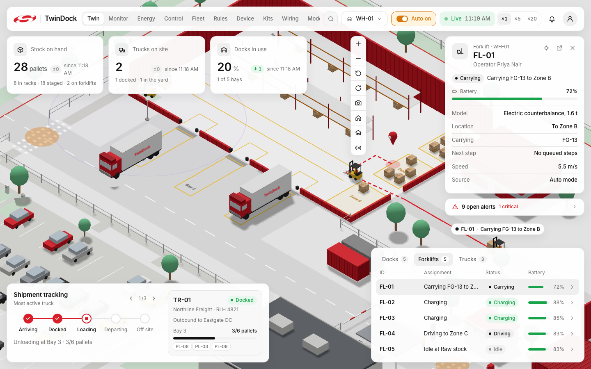

All screenshots in this README were taken from the running app by
[`tools/screenshots/capture.py`](tools/screenshots/capture.py) on 2026-10-13. The real board was not connected,
so every board value reads "Waiting for device". What each image shows: [docs/screenshots/CHECKLIST.md](docs/screenshots/CHECKLIST.md).

## What it is

**The problem.** A warehouse and a factory run on separate systems: the yard, the forklifts, the machines, the
compressor, the energy meters, the people. Each tells part of the story, and nobody sees how one thing causes the
next: a tripped compressor stops the line, and a late truck leaves the dock idle.

**The solution.** TwinDock puts all of it in one live 3D view, shared by every open screen. An operator can move a
forklift from a phone and see it move on the projector. A press with a worn bearing raises an alert, then a work
order that waits for a person to approve. The real board's buttons and LED are part of the same loop.

**Who it is for.** A plant or warehouse manager who wants one picture of the site; an engineer evaluating Silicon
Labs radios for industrial IoT; and anyone judging whether a digital twin can be honest about where its data comes from.

**The Silicon Labs part.** The gateway, GW-01, is a **SiWx917 Wi-Fi 6 + Bluetooth LE Dev Kit (BRD2605A)** running
TwinDock firmware written in C on the WiSeConnect SDK. It publishes its status, buttons, LED state and BLE scans over
MQTT, and it takes LED commands from the twin. Every other device kit in the project is designed around a Silicon Labs
radio: SiWx917 for Wi-Fi, EFR32BG for coin-cell BLE, EFR32MG24 for Thread.

The visual language is inspired by **Dilum Sanjaya's "WareTrack"** concept. TwinDock does not use its name, logo,
wordmarks or truck branding.

## Real vs simulated

This comes first because it is the rule the whole project is built on: **the board is never faked**. A board value
is shown only if the board sent it, with its age. If nothing has arrived, the screen says "Waiting for device".

| Data | Source | Badge in the UI | Where it appears |
|---|---|---|---|
| GW-01 status: Wi-Fi RSSI, uptime, IP, firmware version, message counters | **Real.** MQTT from the SiWx917 board | **LIVE** (violet) | Gateway card on `/twin`, `/control` Gateway tab, `/device`, `/fleet`, `/monitor` |
| BTN0 / BTN1 presses, LED0 / LED1 state | **Real.** The board reports each change; LEDs show on only after the board confirms | LIVE | Gateway card, `/control`, event log |
| BLE tags named `TD-…` (e.g. a phone advertising `TD-BADGE-01` as RB-01) | **Real**, through the board's BLE scan | LIVE | `/device`, `/fleet`, and as live forklifts once zones are calibrated |
| Warehouse trucks, forklifts, pallets, docks | Server world state, moved by a person (`manual`) or auto mode (`auto`) | none; the inspect card's "Source" row says which | `/twin`, `/control` |
| 88 factory and campus devices: machine monitors, worker badges, meters, compressors, generator controller, env, gas, water | **Simulated** by `backend/sim` (via `tools/site_sim.py` or in the backend) | **SIM** (grey) | Everywhere they appear |
| OEE, alerts, work orders, energy totals, weighbridge tickets | Computed by the backend from the data above | Same badge as their inputs | `/twin`, `/monitor`, `/energy`, `/rules`, `/control` |

The separation is enforced in code, not only in the UI. Simulated devices publish on their own topics
(`twin/<site>/<device>/…`) with `source: "sim"` as a schema constant. The backend routes them to a device registry
that has no path to the board's state, its LEDs or its MQTT output. A simulated message that names GW-01 is dropped.
The test `backend/tests/test_sites.py::test_sim_messages_never_touch_the_real_board` checks this on every run.
Every value on every page and its source: [docs/value_audit.md](docs/value_audit.md).

## Features

### Warehouse twin (`/twin`)

An isometric low-poly 3D yard: warehouse with dock doors D1–D3, racks, forklifts, box trucks, pallets and the
gateway pole. KPI cards, open alerts, a 5-step shipment tracker and a docks / forklifts / trucks table float on top.
Click any unit, or search for it with `/`, to open its inspect card. Selection is shared: pick FL-01 on a phone and
the projector shows it too.

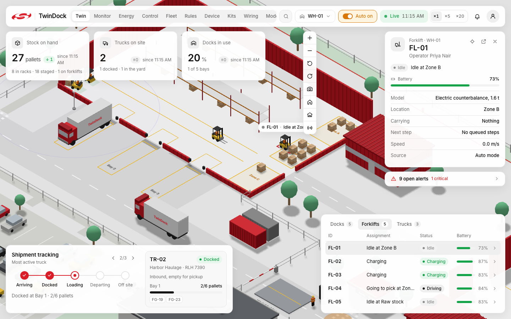

Units move along a waypoint graph at real speeds (forklift 2.2 m/s, truck 3 m/s), played 2.5× faster for the demo
(`TWINDOCK_PACE=1` for real time). Vehicles reserve the lanes ahead of them, so they wait instead of colliding.
In the clip, FL-01 waits for FL-04 to clear the lane, then drives:
[docs/screenshots/forklift-route.mp4](docs/screenshots/forklift-route.mp4).

### Control Room (`/control`)

The operator's page, built for a phone. Pick a unit, pick a destination, see the planned path, confirm. The server
validates every move (one truck per dock, no picking a pallet someone else holds, low battery) and every screen
follows. Tabs for the gateway, the factory line, maintenance approvals, logistics, alerts and the event log.

| Desktop | Phone |
|---|---|
| 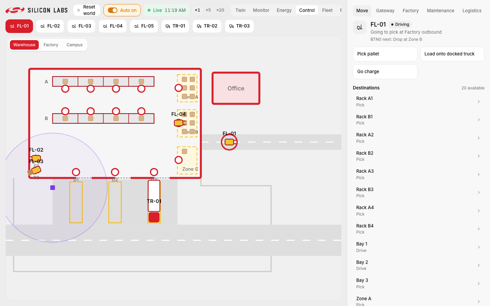 | 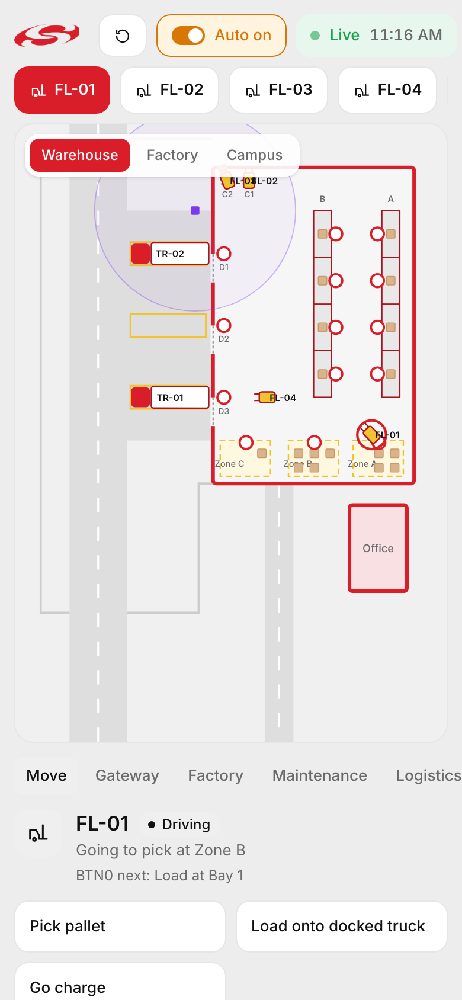 |

### Board and gateway

The SiWx917 board is GW-01 on a pole near the docks, with a violet BLE range ring that is bright only while the
board is online. Its card shows status, LEDs and buttons, all from the board's own messages. With no board connected,
it shows exactly that:

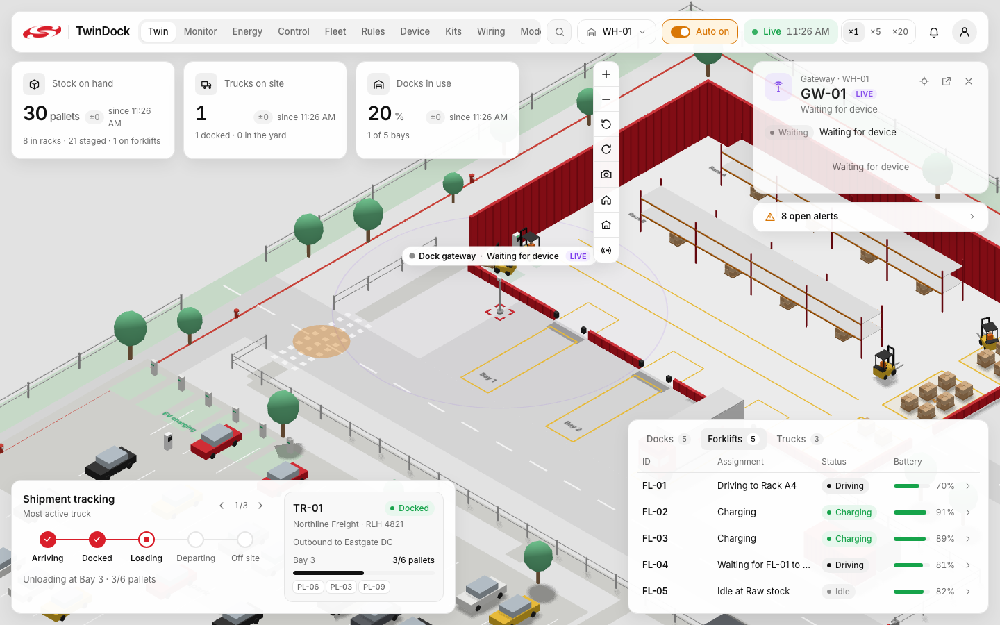

`/device` shows the board's Wi-Fi signal history and the BLE tags it sees, and it has a helper for calibrating BLE
zones on site. Without the board the chart is empty and the tag table says so:

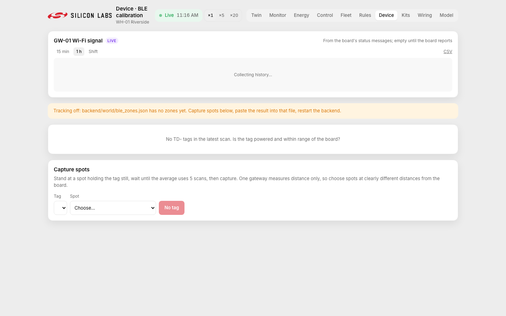

### Fleet (`/fleet`)

Every device in one table: source (LIVE or SIM), protocol, site and zone, status, battery, signal, firmware and last
seen. The "Needs attention" filter lists stale, offline, faulty and low-battery devices. A device is online if its
last message arrived within 15 s, stale up to 60 s, then offline.

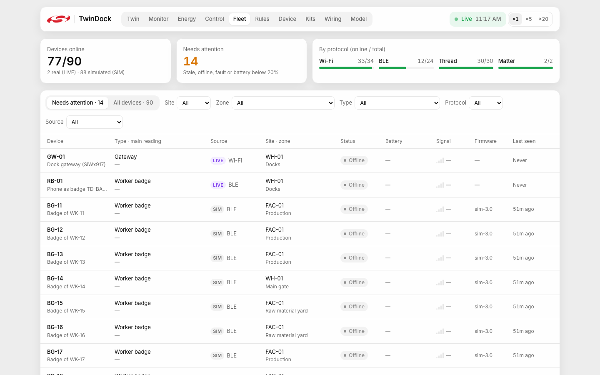

### Production and OEE

FAC-01 "Riverside Assembly" has two lines, each a press feeding a packer through a 12-part buffer (machines M-01 to
M-04). The twin shows units made, availability and OEE (availability × performance × quality), with losses by reason.
Each machine learns its own vibration baseline and raises an alert when it leaves it. A worn bearing becomes a work
order that a person approves on `/control`.

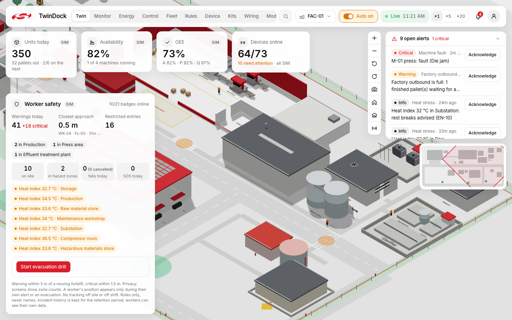

### Worker safety

Simulated BLE badges give zone counts, warnings when a worker is within 3 m of a moving forklift (critical within
1.5 m), restricted-zone entries, heat-stress advice and evacuation drills (panel on the left above). It is private by
default. Screens show counts per zone. A worker's position appears only during their own alert or an evacuation.
Badges carry roles, never names. Workers can see their own data at `/me/<worker>`. Safety features advise; they never
lock, close or silence anything.

### Cold room and docks

The cold room inside FAC-01 has climate sensors and a door sensor; rules warn when the temperature leaves 0–5 °C for
30 s or the door stays open over 60 s (see the rules list below). The warehouse docks have their own kit design (dock
bay monitor), and Bay 1 drives the real board's LED0: it is on while a truck is docked there.

### Energy and utilities (`/energy`)

Demand, solar, grid import, generator, power factor, 15-minute demand and the day's cost, plus kW by building. In a
grid failure the generator controller confirms, cranks, runs up and transfers the critical loads within 9 s; the
production line and EV chargers are shed. The compressed-air system has a duty and a standby compressor with a real
start delay.

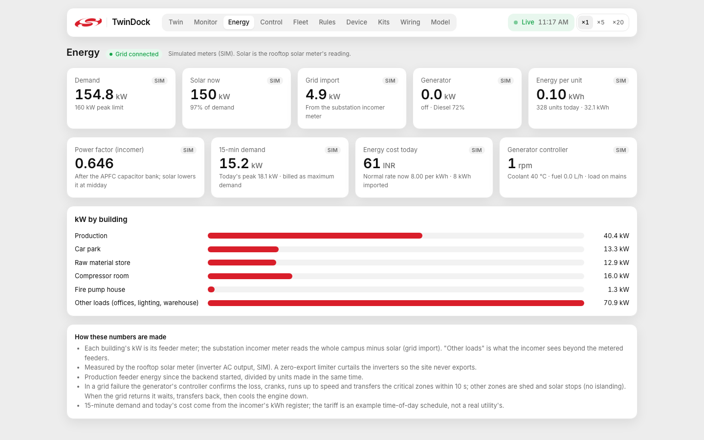

### Rules and alerts (`/rules`)

32 rules, each written in plain language next to its condition, in `backend/rules/*.yaml`. An alert is raised when a
condition holds for its whole duration, can be acknowledged, and resolves when the condition clears. Values that never
arrived, or are stale, never trigger a rule.

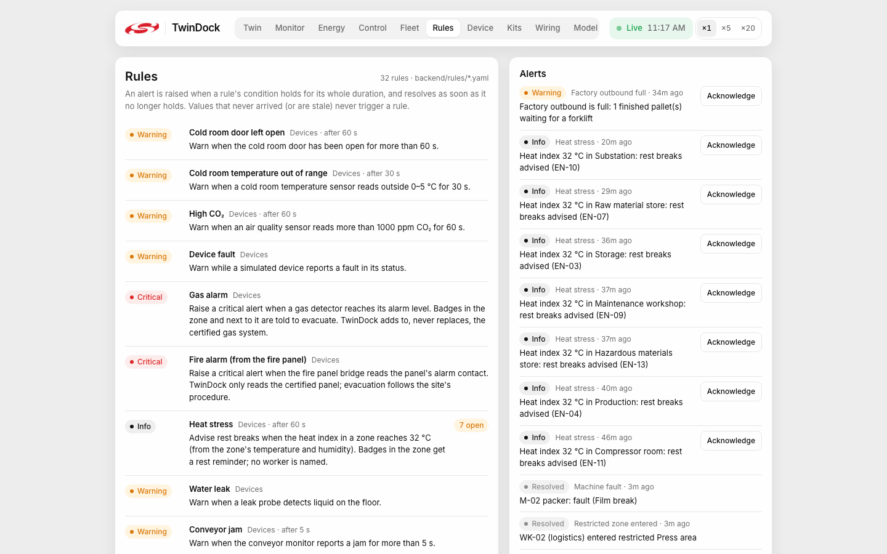

### Monitoring centre (`/monitor`)

A control-room wall display: the whole campus, open alerts with an incident timeline, worker safety, and a KPI strip
for production, logistics, energy, air quality, device health and the real board.

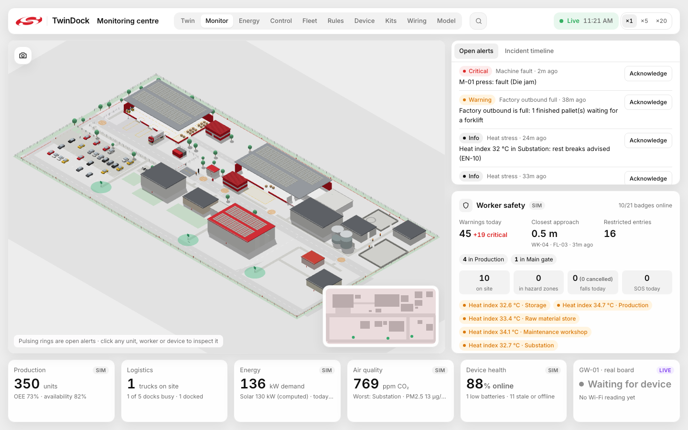

### Device kits and wiring (`/kits`, `/wiring/:kit`)

One sensor kit per kind of asset, 18 in all, each a JSON file in `hardware/kits/`: parts, buses, I2C addresses,
pins, wires and bill of materials. **Only the forklift kit (FL-01) is built**, on the real board. The other 17 use
real, buyable parts with a correct wiring plan, and their data is simulated. The wiring pages draw every part to scale
in breadboard and schematic views and show "Built and verified" or "Simulated kit".

| Kit index | A simulated kit (machine monitor) |
|---|---|
| 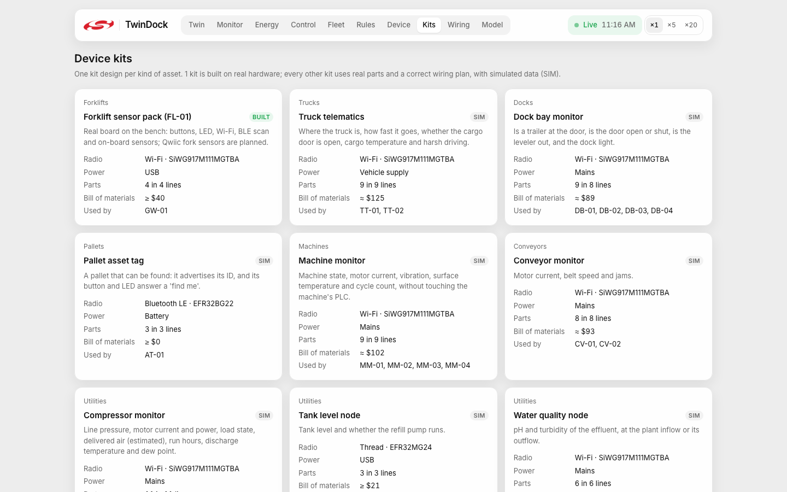 | 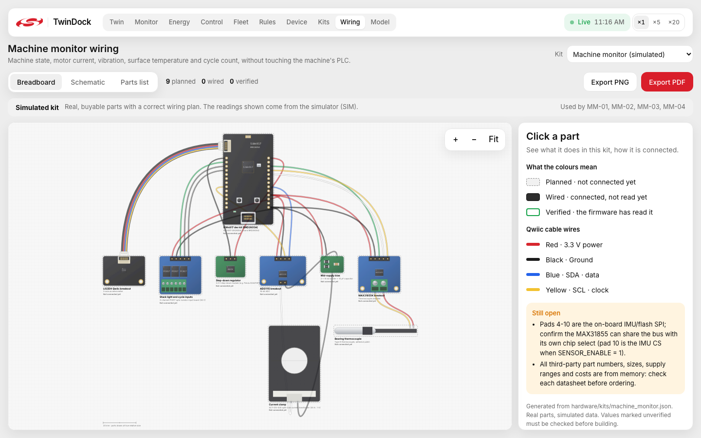 |

### Factory planner

Not built yet. A `/plan` page with a capacity simulation is on the roadmap (site step S8). There is no screenshot,
because there is nothing to show.

## Architecture

```
SiWx917 board ──MQTT (Wi-Fi)──► Mosquitto (laptop) ◄──► backend (FastAPI, Python)
      ▲                                                   │  world state + movement engine
      └──── twin/gateway/cmd/* (LED commands) ◄───────────┤
                                                          ▼ WebSocket
                                  ┌───────────────────────┴───────────────────────┐
                                  │  /twin  3D view + HUD    /control  Control Room │
                                  │  /device  board page     /wiring  sensor pack   │
                                  └─────────────────────────────────────────────────┘
```

Simulated devices join the same broker on `twin/<site>/<device>/<channel>`. With no broker, as on a hosted demo,
the backend runs the same simulator in-process (`TWINDOCK_SIM=auto`). The backend is the single source of truth.
Browsers send intents, the backend validates them, updates the world at 20 Hz and broadcasts. No browser moves a unit
on its own.

**From the board to the screen.** The board publishes `twin/gateway/status` every 5 s → the backend validates it
against `shared/schemas/mqtt/gateway_status.json` and stores it with its receive time → it broadcasts `gateway_update`
over `/ws` → every browser shows the value with its age. After 15 s with no status, the board is shown offline and its
last values are greyed out.

**From a click to the board's LED.**

1. A user flips LED1 in the gateway card. The browser sends `led_command`. The switch shows "pending", not "on".
2. The backend publishes `twin/gateway/cmd/led` `{led, on, cmd_id}` to the board.
3. The board sets the LED and publishes `twin/gateway/led` with the same `cmd_id`.
4. Only that confirmation turns the LED on in the UI, on every screen. If no confirmation arrives within 5 s, the
   event log says so and the UI does not pretend.

Code map: [`backend/twindock/`](backend/twindock) (`engine.py` routes every message, `world.py` units and movement,
`gateway.py` board state, `devices.py` simulated devices, `rules.py`, `control.py`, `production.py`, `safety.py`) and
[`frontend/src/`](frontend/src) (`store/` changes only on server messages, `scene/` the 3D world, `hud/`, `pages/`).
Message types are generated from `/shared` and validated at runtime on both ends.

## Hardware

**Board:** Silicon Labs SiWx917 Wi-Fi 6 + BLE SoC Dev Kit (SIWX917-DK2605A, board BRD2605A rev A02, SoC
SiWG917M111MGTBA), powered over USB-C. The full verified inventory, with the source of each fact, is in
[HARDWARE.md](HARDWARE.md).

| On the board | Part | Bus / pin | Used by TwinDock |
|---|---|---|---|
| BTN0 | push button | UULP_VBAT GPIO 2 | Runs the selected forklift's next task |
| BTN1 | push button | HP GPIO 49 | Selects the next forklift (on every screen) |
| RGB LED | one LED, three channels | red GPIO 50, green GPIO 51, blue GPIO 15 | LED0 = green (truck at Bay 1), LED1 = blue (manual from the twin) |
| Temperature + humidity | Si7021 | ULP I2C, 0x40 | Planned: `sensor/temperature`, `sensor/humidity` |
| Ambient light | VEML6035 | ULP I2C, 0x29 | Planned, gated until verified |
| 6-axis IMU | ICM-40627 | ULP SPI | Planned (motion, impact), gated |

**Forklift sensor pack** ([`hardware/kits/fl01_sensor_pack.json`](hardware/kits/fl01_sensor_pack.json)): the board
plus two Qwiic modules on one cable, a VL53L1X time-of-flight sensor for fork height and a NAU7802 ADC with a load cell
for fork load. The on-board parts are wired by the board itself. The Qwiic modules are **planned**: their exact
breakout models are still an open question in the kit file.

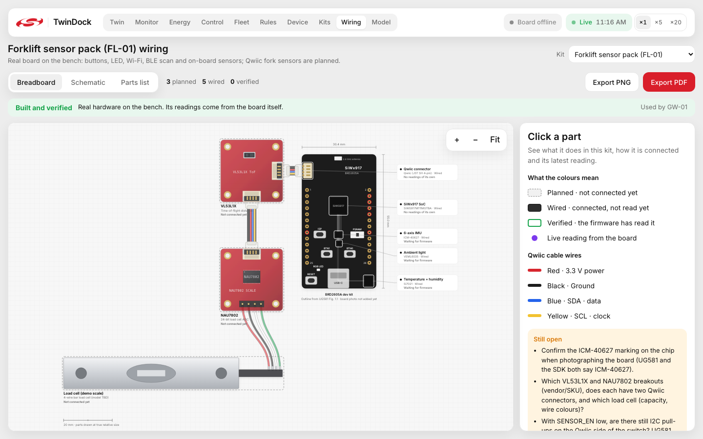

| Qwiic wire | Signal | Board net |
|---|---|---|
| Red | 3.3 V | VMCU (not switched by SENSOR_EN) |
| Black | GND | GND |
| Blue | SDA | ULP_GPIO_6, shared with the on-board I2C sensors |
| Yellow | SCL | ULP_GPIO_7, shared with the on-board I2C sensors |

**I2C address map and the VL53L1X fix.** The VL53L1X powers up at 0x29, the same address as the on-board VEML6035.
The kit's boot sequence solves it: drive SENSOR_EN low, which disconnects the on-board sensors, so only Qwiic devices
answer. Then move the VL53L1X to 0x30 (or find it already there after an MCU-only reset), confirm its model ID
(0xEACC), and switch the on-board sensors back on. The bus then holds VEML6035 0x29, NAU7802 0x2A, VL53L1X 0x30 and
Si7021 0x40, with no clashes. If the VL53L1X does not answer, the firmware reports an error and never a value. This is
**designed and checked by the kit validator, not yet in the firmware** (see the next section).

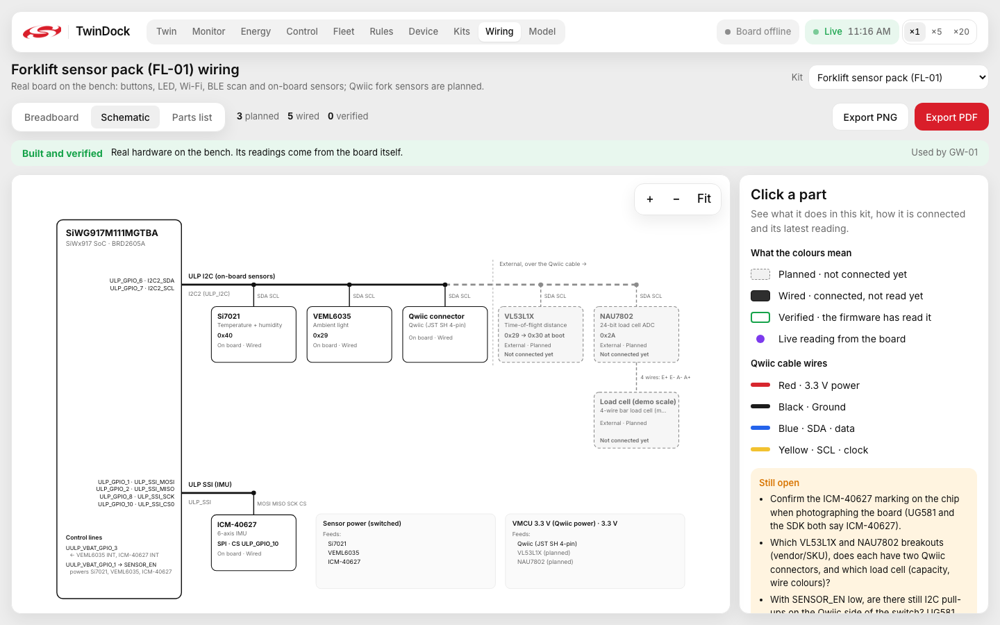

## Firmware

Project: [`firmware/twindock_gw/`](firmware/twindock_gw), generated with `slc` from the WiSeConnect example
`wifi_embedded_mqtt_client_soc` for BRD2605A, built against WiSeConnect 4.1.1 on Simplicity SDK 2026.6.1.

| Step | What it does |
|---|---|
| A | Joins Wi-Fi, connects to the broker, publishes the retained `hello` (board, firmware version, LEDs, buttons, sensors) |
| B | `twin/gateway/status` every 5 s: uptime, RSSI, IP, firmware version, messages sent, reconnects |
| C | BTN0 / BTN1 debounced (30 ms) and published on each change |
| D | Subscribes to `cmd/led`, drives the RGB LED's green and blue channels, confirms each change with the command's `cmd_id` |
| E | BLE scan for `TD-` tags: **not written yet** |
| F | Offline buffer, replay and reconnect counters: **not written yet** |

**Switches.** In `td_config.h`, `TD_ENABLE_STEP_B_STATUS`, `TD_ENABLE_STEP_C_BUTTONS` and `TD_ENABLE_STEP_D_LEDS`
turn steps B–D on and off, so they can be brought up one at a time. Step A is always on. Wi-Fi and broker settings go
in `td_secrets.h`, which is gitignored (copy `td_secrets.example.h`).

**Version scheme.** `fw_version` is the semantic version plus the steps compiled in, e.g. `0.2.0+ABCD`, so the twin
shows exactly which features the flashed build has. `hello` lists only the LEDs and buttons whose step is enabled.

**Build and flash:** `cd firmware/twindock_gw && make -j8 -f twindock_gw.Makefile`, then flash with Simplicity
Studio or Commander. Update the network processor firmware first. Every step, and what the console and
`mosquitto_sub` should show: [firmware/TESTING.md](firmware/TESTING.md).

**Status: Steps A–D are written and build with 0 errors and 0 warnings (all 8 step combinations), but they are untested
on hardware.** No board has run this firmware yet. The NWP update and the physical checks in HARDWARE.md are still open.

## The MQTT contract

The JSON Schemas in [`shared/schemas/`](shared/schemas) are authoritative, and [`shared/schema.md`](shared/schema.md)
explains them. Both the backend and the frontend validate against the same files. Each example below validates
against its schema.

| Topic | Direction | Payload | Example |
|---|---|---|---|
| `twin/gateway/hello` | board → (retained) | `{board, radio_board, fw_version, leds[], buttons[], sensors[]}` | `{"board":"BRD2605A","radio_board":"","fw_version":"0.2.0+ABCD","leds":["LED0","LED1"],"buttons":["BTN0","BTN1"],"sensors":[]}` |
| `twin/gateway/status` | board →, every 5 s | `{ts_ms, uptime_s, wifi_rssi_dbm, wifi_connected, ip, fw_version, msgs_sent, reconnects, buffered, replay}`; only `ts_ms` required | `{"ts_ms":125000,"uptime_s":125,"wifi_rssi_dbm":-58,"wifi_connected":true,"ip":"192.168.1.42","fw_version":"0.2.0+ABCD","msgs_sent":31,"reconnects":0}` |
| `twin/gateway/button` | board →, on change | `{ts_ms, button, state}` | `{"ts_ms":131250,"button":"BTN0","state":"pressed"}` |
| `twin/gateway/led` | board →, on change | `{ts_ms, led, on, cmd_id?}`, a confirmation, not a command | `{"ts_ms":140020,"led":"LED1","on":true,"cmd_id":"lc-6f1d2a"}` |
| `twin/gateway/ble` | board →, every 2 s | `{ts_ms, sightings: [{name, addr, rssi_dbm}]}`, names starting `TD-` | `{"ts_ms":142000,"sightings":[{"name":"TD-BADGE-01","addr":"5C:F3:70:12:9A:01","rssi_dbm":-67}]}` |
| `twin/gateway/sensor/<name>` | board → | `{ts_ms, value, unit}`, only sensors in HARDWARE.md | `{"ts_ms":150000,"value":23.4,"unit":"°C"}` (no firmware step publishes sensors yet) |
| `twin/gateway/cmd/led` | → board | `{led, on, cmd_id}`, `cmd_id` ≤ 36 chars, from the backend | `{"led":"LED1","on":true,"cmd_id":"lc-6f1d2a"}` |

Simulated devices use `twin/<site>/<device>/hello|status|<channel>` and receive simulator commands on
`twin/<site>/<device>/cmd/<action>` (schemas `mqtt/site_*.json`, `source` always `"sim"`). The WebSocket messages
between the backend and browsers are listed in [shared/schema.md](shared/schema.md).

## Simulation models

Every SIM value comes from a cause-and-effect model in [`backend/sim/`](backend/sim). Machines draw air and power
because they run; the compressor loads because pressure fell; the generator starts because the grid failed. Randomness
appears only where real plants are random, always through a named distribution and a seeded stream.

| Model | Chain of cause and effect |
|---|---|
| Compressed air | Duty compressor trips → supply < demand + leaks → header pressure falls → below 6 bar an alert, below 5 bar the presses and packers stop → the standby starts after its sequencer delay and star-delta start → pressure recovers → above 5.8 bar the line restarts |
| Electrical | Mains lost → the generator controller confirms (2 s), cranks (3 s), runs up (4 s) and transfers the critical bus → non-critical zones shed → fuel falls; mains back → wait 60 s → transfer back → 2 min cool-down → stop |
| Production | Raw pallets (moved by the twin's forklifts) → press → buffer → packer, with starving and blocking → Weibull minor stops → bearing wear grows until it fails, unless a work order replaces it → OEE from the event log |
| Rooms and people | Outdoor weather + equipment heat → room temperature and humidity → heat index → rest-break advice; three-shift roster through the gate, canteen breaks, evacuation walks, BLE position error |
| Logistics | Truck slot + delay → gate → weighbridge (tare + the pallets actually on board) → yard queue → dock → forklifts unload (battery Ah drawn) → paperwork → out |
| Measurement | Every reading passes through its kit's real sensor: report period, noise, resolution, range, dropouts |

**Parameters.** All 371 parameters live in `backend/sim/params/*.yaml`, each with a value, a unit and a source:
40 from datasheets, 17 from standards, 144 typical values and 170 labelled assumptions. The `/model` page lists them
all, with every equation and the validation run. Details: [docs/model_card.md](docs/model_card.md),
[docs/sim_architecture.md](docs/sim_architecture.md).

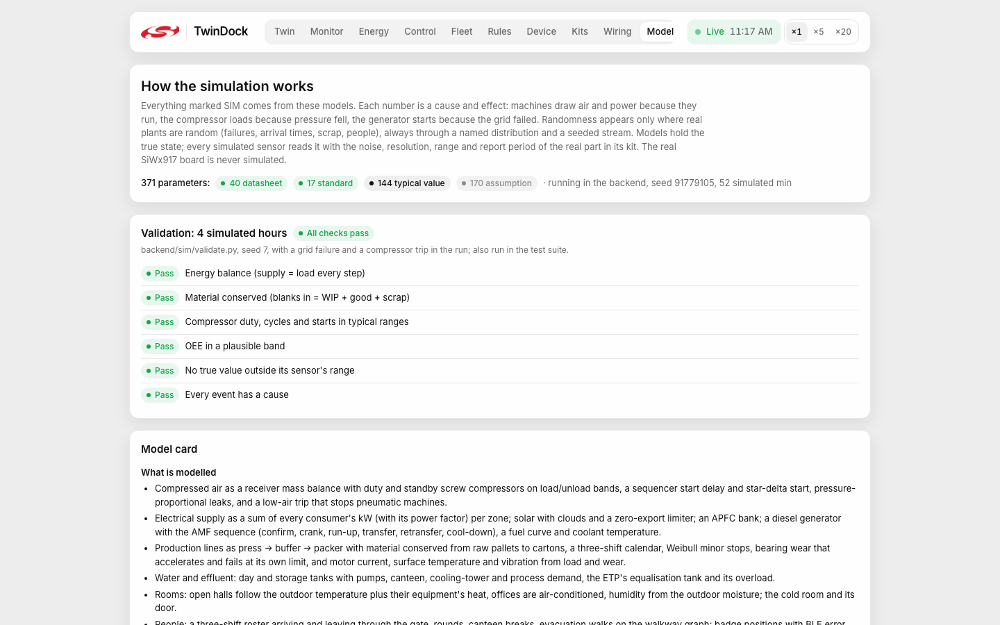

**Validation** (`backend/sim/validate.py`, 4 simulated hours with a grid failure and a compressor trip): energy balance,
material conservation, compressor duty, plausible OEE, sensor ranges and "every event has a cause" all pass. Raw
results: [docs/validation.json](docs/validation.json). The model is plausible, not calibrated against a real plant,
and should not be used to size equipment.

## Engineering decisions

The full log, one line per decision, is in [DECISIONS.md](DECISIONS.md). The most important ones:

| Decision | Reason | Trade-off |
|---|---|---|
| The LED shows "on" only after the board confirms | A twin that shows the click, not the hardware, lies whenever the command is lost | The switch shows a short pending state; a lost command shows as a timeout, not a success |
| One backend process with exactly one worker, the single source of truth | Two workers would be two separate worlds; clients that move units locally drift apart | It scales up, not out. That is fine for one site |
| Vercel was dropped for one always-on container | Serverless froze the 20 Hz loop and the simulator between requests, started fresh worlds on cold starts and could not hold `/ws` ([docs/deploy_diagnosis.md](docs/deploy_diagnosis.md)) | Free hosts sleep when idle; the first visit takes about a minute |
| GW-01 is never stored in the simulated device registry; its entry is derived from the board's messages | No code path can let a simulated value become a board value | Two device paths in the backend instead of one |
| `source: "sim"` is a schema constant on every site topic | A simulated message cannot claim to be real, even by mistake | None worth noting |
| Speeds ×5 and ×20 are refused while the real board is online | The board's 15 s staleness and the LED timeout are real-time rules | The fast-forward demo needs the board unplugged |
| Anything that stops production or calls emergency services waits for a person | The twin recommends; people decide | The demo needs a tap to approve the bearing change |
| Firmware built against WiSeConnect 4.1.1, not the 3.5.3 copy in the repo | 3.5.3 needs an SDK that is not installed; the board's button and LED configs are byte-identical in both | HARDWARE.md cites 3.5.3 paths; the NWP must be updated to the 4.1.1 image |

## Testing and quality

| Check | Result | When |
|---|---|---|
| Backend tests (`cd backend && ../.venv/bin/python -m pytest -q`) | 290 passed, 1 warning (4 min 2 s) | 2026-10-13 |
| `test_sim_messages_never_touch_the_real_board` | passed (part of the run above) | 2026-10-13 |
| Frontend tests (`cd frontend && npm test`) | 16 passed, 0 failed | 2026-10-13 |
| TypeScript typecheck (`npm run typecheck`, strict) | clean | 2026-10-13 |
| Container (`docker build` + `docker run`, `scripts/verify_live.py` for 6 min) | All checks pass: units move, compressor pressure cycles, the generator takes load in a grid failure, the line counts units; tick loop 18.6 Hz; warm start 7.9 s for 45 simulated minutes | 2026-10-12 ([RUN_REPORT.md](RUN_REPORT.md)) |
| Simulation validation | All 6 checks pass | 2026-10-12 |

**Performance.** A 15-minute soak on a production build (Apple M1, auto mode on) held 60 fps on `/twin` and
`/control`, also with 4× CPU throttling, with flat memory. That was on 2026-10-08, when the twin was the warehouse
only. The full campus was measured afterwards with a frame-stepping bench, not a 15-minute soak: 10.5 ms average and
12.1 ms p95 per frame for the campus overview, 564 draw calls and 132 MB of JS heap ([docs/perf_report.md](docs/perf_report.md)).
Under 16.7 ms a frame means 60 fps is achievable. Real fps on the full campus is still to be confirmed by eye.

**Not tested:** the firmware on a real board, the BLE zones on site, and the hosted deploys (they need the owner's
accounts).

## Run it locally

**Prerequisites:** Python 3.11+, Node 22 (the version the Dockerfile builds with), and Mosquitto (`brew install mosquitto`) if you want the real board.

```sh
python3 -m venv .venv
.venv/bin/pip install -r backend/requirements.txt -r tools/requirements.txt
(cd frontend && npm install)
```

If `python3 -m venv` fails at `ensurepip` (it does with Homebrew's Python 3.14 on the development Mac), use the
python.org installer instead, e.g. `/Library/Frameworks/Python.framework/Versions/3.13/bin/python3.13 -m venv .venv`.

**Run** (three terminals):

```sh
./scripts/run_broker.sh       # Mosquitto on 0.0.0.0:1883; prints the laptop IP for the firmware
./scripts/run_backend.sh      # http://localhost:8000, WebSocket /ws
cd frontend && npm run dev    # http://localhost:5173
```

Open `http://localhost:5173/twin`, and `http://<laptop-ip>:5173/control` on a phone on the same Wi-Fi. Without a
broker, the backend runs the simulated campus in-process. It first fast-forwards 45 simulated minutes (a few seconds),
so the factory is already running when the page opens.

**Docker** (one container: the built frontend, `/api` and `/ws`, no broker needed):

```sh
docker build -t twindock . && docker run --rm -p 7860:7860 twindock    # http://localhost:7860
```

**Simulated site devices over a real broker:** `.venv/bin/python tools/site_sim.py` (or `--zones cold_room` for
some zones only).

**Fake board: development only.** `.venv/bin/python tools/fake_board.py` publishes the board's topics with
`board: "FAKE"`, and every page shows a red FAKE BOARD banner. Never use it in a demo. Afterwards, clear its retained
hello with `mosquitto_pub -r -n -t twin/gateway/hello`.

**Tests and screenshots:**

```sh
(cd backend && ../.venv/bin/python -m pytest -q)
(cd frontend && npm test && npm run typecheck)
.venv/bin/pip install -r tools/screenshots/requirements.txt && .venv/bin/python -m playwright install chromium   # once
.venv/bin/python tools/screenshots/capture.py      # app must be running; --base http://localhost:7860 for Docker
```

| Endpoint | What |
|---|---|
| `GET /api/health` | Uptime, tick rate, simulation clock and speed, devices online, broker, board online or fake |
| `GET /api/snapshot`, `GET /api/layout` | The world (same as the WebSocket snapshot) and the static geometry |
| `POST /api/reset` | Restore the seed world (board data is kept: it is real) |
| `GET /api/history?device=&channel=&range=15m\|1h\|shift` | Historian series for charts (`/api/history.csv` for CSV) |
| `GET /api/report/shift.pdf` | Shift report PDF from the historian |
| `GET /api/model` | The simulation's model card and parameters |
| `GET /api/kits`, `GET /api/kits/{id}` | Device kits for `/kits` and `/wiring` |
| `WS /ws` | Every message in [shared/schema.md](shared/schema.md) |

## Deploy

TwinDock runs as one always-on Docker container. Hosted, it runs the simulated campus, says "Hosted demo" on every
page and shows the real board as "Waiting for device".

- **Hugging Face Spaces** (Docker SDK, free CPU): `HF_SPACE=<user>/twindock ./scripts/push_hf_space.sh`.
- **Render** (Blueprint from `render.yaml`, free plan, health check `/api/health`).
- **An always-on VM** with Mosquitto and Caddy HTTPS, so the real board can reach it: [docs/deploy_vm.md](docs/deploy_vm.md).

Click-by-click steps and environment variables: [docs/deploy.md](docs/deploy.md). No secret is stored in the repository.

## Limitations and roadmap

**Simulated:** everything except GW-01 and the BLE tags it sees: the factory, utilities, people, truck telematics
and 17 of the 18 device kits.

**Not built yet:**
- Firmware Step E (BLE scan) and Step F (offline buffer, replay, reconnect counters), and running Steps A–D on the board.
- The board twin (a 3D model of the board in the gateway card): it needs a top-down photo, `frontend/public/board/top.jpg`.
- BLE tags as live forklift zones: built, but the zones need calibration on site at `/device`.
- The forklift sensor pack's Qwiic modules (VL53L1X, NAU7802, load cell) and the on-board sensor topics.
- Over-the-air firmware updates, and TLS between the board and the broker (the board uses plain MQTT on the LAN today).
- The factory planner (`/plan`) and site steps S4, S5, S7, S8 and S9 ([SITE_PROMPTS.md](SITE_PROMPTS.md)).
- Building the other 17 kits on real hardware.

**Next:** flash and test Steps A–D, write E and F, photograph the board for the board twin, buy and wire the Qwiic
modules, then calibrate BLE zones in a real space.

## Repository layout

| Path | What |
|---|---|
| `firmware/` | Simplicity Studio project for the SiWx917 (WiSeConnect SDK, C) and its test plan |
| `backend/` | FastAPI + aiomqtt: world state, movement engine, rules, control loop, historian, WebSocket hub |
| `backend/sim/` | The cause-and-effect simulation, with its sourced parameters |
| `frontend/` | Vite + React + TypeScript + React Three Fiber + zustand + Tailwind: every page |
| `shared/` | `schema.md` and the JSON Schemas for every MQTT and WebSocket message |
| `hardware/kits/` | One JSON file per device kit (parts, pins, wires, bill of materials) |
| `tools/` | `site_sim.py` (SIM devices), `fake_board.py` (development only), kit and campus generators, `screenshots/` |
| `scripts/` | Run the broker and backend, live checks, the Hugging Face push |
| `broker/`, `deploy/` | Mosquitto config; the always-on VM setup |
| `docs/` | Plans, model card, deploy guides, performance and value audits, screenshots |
| `HARDWARE.md` | Verified inventory of the physical board |

## Credits and licenses

- **Design inspiration:** Dilum Sanjaya's "WareTrack" concept. TwinDock does not use its name, logo, wordmarks or truck branding.
- **Silicon Labs:** the logo, SiWx917, EFR32 and Simplicity Studio are Silicon Labs names, used here only to say
  what TwinDock is built on. This is a demonstration project, not a Silicon Labs product.
- **Part graphics:** every part on the wiring pages is drawn in SVG from its real dimensions. No third-party artwork
  is used ([CREDITS.md](CREDITS.md)).
- **Open-source software:** React, three.js, React Three Fiber, drei, zustand, Tailwind CSS, Vite, FastAPI, pydantic,
  Eclipse Mosquitto, aiomqtt, jsonschema, PyYAML and Playwright, under their own licenses.
- **License:** Apache License 2.0 ([LICENSE](LICENSE)). The Silicon Labs names and logo are not covered by it.
